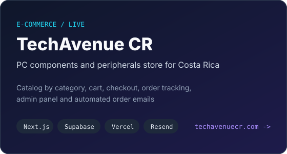
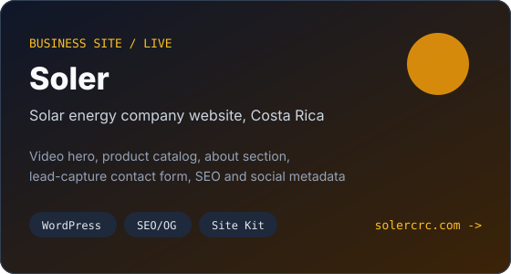

  

  
  
  

## About

I build fast, conversion-focused websites and online stores for small businesses. I run **ByteClub Dev**, working with a variety of businesses, hospitality, wellness and retail clients from Costa Rica to the US, Europe and beyond.

- Full-stack e-commerce: catalog, cart, checkout, order management, admin panels
- Business and brand sites that turn visits into WhatsApp messages, calls and leads

## Featured work

<table>
  <tr>
    <td width="50%" valign="top">
      
       
      <b>TechAvenue CR</b> - Online store for PC components, peripherals and laptops shipping across Costa Rica.
      <ul>
        <li>Category catalog with dynamic routes and featured products</li>
        <li>Global cart, checkout with two payment methods</li>
        <li>Password-protected admin panel and order management</li>
        <li>Transactional emails with Resend</li>
      </ul>
      <code>Next.js App Router</code> <code>Supabase</code> <code>Vercel</code> <code>Resend</code>
    </td>
    <td width="50%" valign="top">
      
       
      <b>Soler</b> - Website for a Costa Rican solar energy company with 15+ years and 160+ projects.
      <ul>
        <li>Video hero and clear savings-focused messaging</li>
        <li>Product catalog and about section</li>
        <li>Lead-capture contact form with success and error states</li>
        <li>Open Graph and Twitter card metadata, analytics</li>
      </ul>
      <code>WordPress</code> <code>SEO</code> <code>Google Site Kit</code>
    </td>
  </tr>
</table>

## Stack

  

  
  

## Work with me

Need a website or online store? Reach out.

  

