### Hi, I'm Wesley. I build websites and online stores that sell.

Co-founder of [ByteClub Dev](https://byteclubdev.com), a web studio in Costa Rica working with clients worldwide.

---

## Case study: TechAvenue CR

| | |
|---|---|
| **Client** | PC components retailer, Costa Rica |
| **Live** | [techavenuecr.com](https://techavenuecr.com) |
| **Role** | Design, full-stack development, deployment |
| **Stack** | Next.js App Router, Supabase, Vercel, Resend |

**The problem.** The client needed a trustworthy online store for PC parts with real inventory, local payment methods and a simple way to manage orders without a developer.

**What I built.**
- Catalog across 10+ categories with dynamic category pages and a featured-products section managed from the database
- Persistent global cart and a checkout supporting two payment methods
- Password-protected admin panel to manage orders and featured items
- Automated order confirmation emails sent from the store's own domain

**Highlights.** Responsive design with a video hero, WhatsApp pre-sales link, order tracking and full policy pages for warranty and returns.

---

## Case study: Soler

| | |
|---|---|
| **Client** | Solar energy installer, Costa Rica |
| **Live** | [solercrc.com](https://solercrc.com) |
| **Role** | Design and development |
| **Stack** | WordPress, Google Site Kit |

**The problem.** A company with 15+ years of experience and 160+ installs needed a site that explains the value of solar in plain terms and turns visitors into quote requests.

**What I built.**
- Video hero with a clear savings-first message
- Benefits section covering bills, battery independence and panel lifespan
- Product catalog and about page
- Contact form with validation states, plus Open Graph metadata for clean social sharing

---

## Toolbox

`Next.js` `React` `JavaScript` `Supabase` `Vercel` `WordPress` `Shopify` `Tailwind` `Git`

## Contact

[byteclubdev.com](https://byteclubdev.com)
